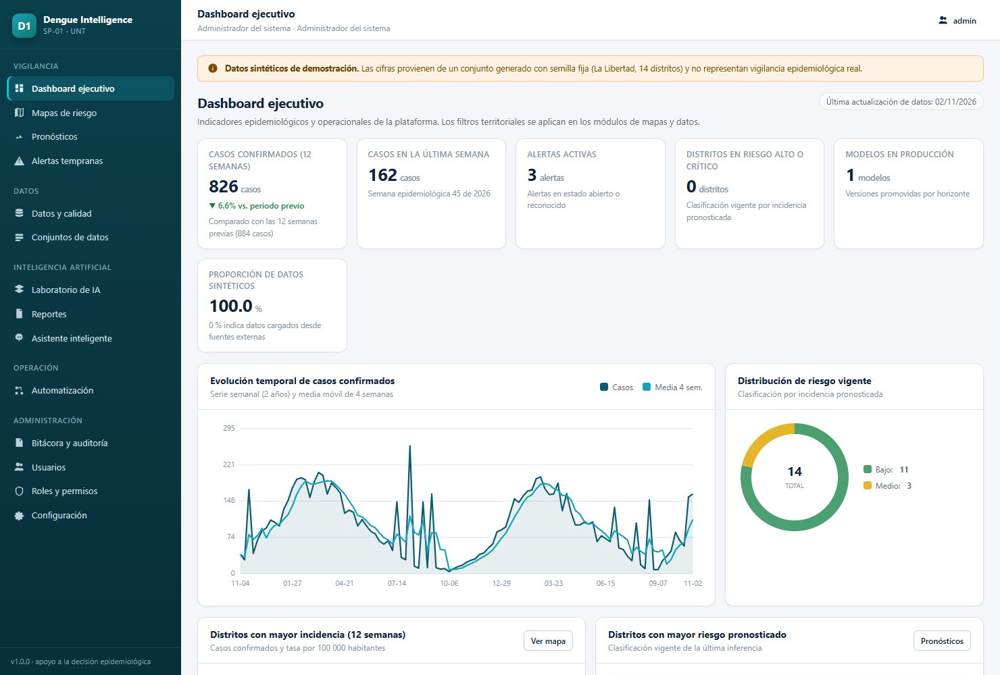
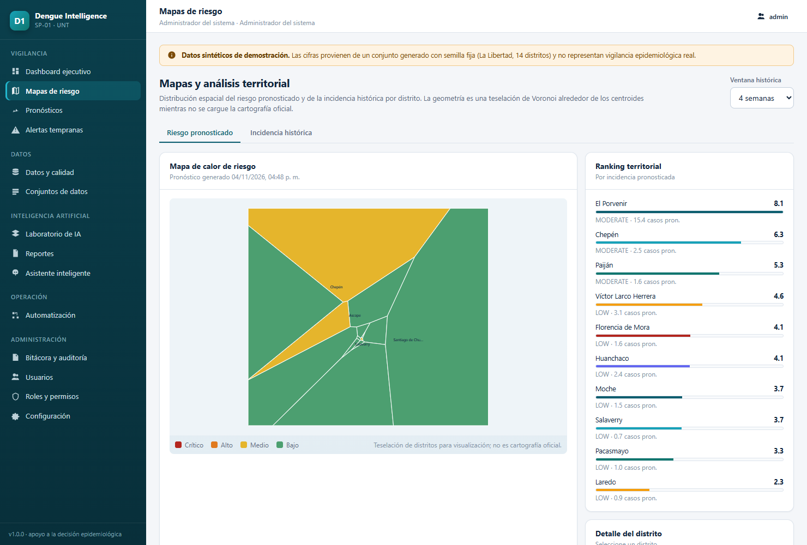
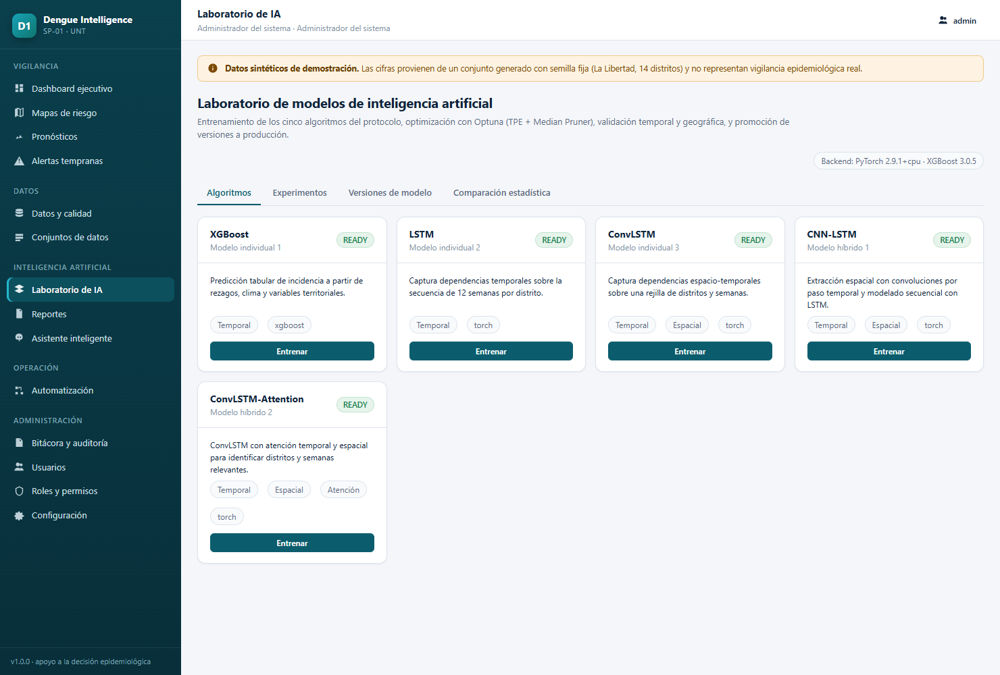

# SP-01 DENGUE INTELLIGENCE

**Sistema Inteligente de Predicción Espacio-Temporal y Alerta Temprana de Brotes de Dengue**

Plataforma web funcional de apoyo a la decisión epidemiológica que integra datos climáticos,
ambientales, geoespaciales y de vigilancia para pronosticar casos de dengue por
**distrito-semana epidemiológica**, clasificar el riesgo, emitir alertas tempranas y explicar los
factores asociados.

> **Aviso de alcance.** Es un sistema de apoyo a la decisión epidemiológica. **No** realiza
> diagnóstico clínico individual ni sustituye la vigilancia epidemiológica oficial.
>
> **Datos de demostración.** El entorno arranca con un conjunto **sintético** generado con semilla
> fija para 14 distritos de La Libertad (Perú). Está marcado como sintético en la base de datos, en
> la API y en la interfaz. No representa un brote real.



| | |
|---|---|
|  |  |

---

> [!TIP]
> **¿Eres el docente o evaluador del proyecto?**  
> Hemos preparado una guía simplificada de 3 pasos para poner en marcha el sistema en menos de 2 minutos sin necesidad de instalar Node.js ni compilar assets. Consulta el archivo adjunto **[INSTRUCCIONES_EVALUADOR.md](INSTRUCCIONES_EVALUADOR.md)**.

---

## 1. Puesta en marcha (verificada en este entorno)

Requisitos: Python 3.12 y (opcional) Node.js 22 para recompilar el frontend.

```powershell
# 1) Dependencias del backend en ./libs (instalación aislada, sin tocar el Python del sistema)
python -m pip install --target .\libs -r backend\requirements.txt

# 2) Arranque de la API + frontend compilado
python run_api.py
```

La aplicación queda en **http://127.0.0.1:8000** y la documentación OpenAPI en
**http://127.0.0.1:8000/api/docs**.

En el primer arranque se crean las tablas, se siembran roles/permisos, el catálogo geográfico, el
calendario epidemiológico y el conjunto sintético (≈5 740 registros distrito-semana).

### Credenciales iniciales

| Rol | Correo | Contraseña |
|---|---|---|
| Administrador del sistema | `admin@dengai.unt.edu.pe` | `Admin#Dengue2025` |
| Administrador epidemiológico | `admin.epi@dengai.unt.edu.pe` | `Demo#Dengue2025` |
| Epidemiólogo | `epidemiologo@dengai.unt.edu.pe` | `Demo#Dengue2025` |
| Analista de datos | `analista@dengai.unt.edu.pe` | `Demo#Dengue2025` |
| Investigador | `investigador@dengai.unt.edu.pe` | `Demo#Dengue2025` |
| Auditor | `auditor@dengai.unt.edu.pe` | `Demo#Dengue2025` |
| Usuario de consulta | `consulta@dengai.unt.edu.pe` | `Demo#Dengue2025` |

Todas las cuentas se crean con `must_change_password = true`. **Cambie las contraseñas** y defina
`SECRET_KEY` en `.env` antes de cualquier despliegue real (ver `.env.example`).

### Frontend en modo desarrollo

```powershell
cd frontend
npm install
npm run dev      # http://127.0.0.1:5173 con proxy a /api
npm run build    # genera frontend/dist, servido por FastAPI en /
```

### Pruebas

```powershell
$env:PYTHONPATH="$PWD\libs;$PWD\backend;$PWD"
python -m pytest backend/tests -q
```

Cobertura actual: autenticación y RBAC, integridad de la bitácora (incluida detección de
manipulación), importación y calidad de datos, particiones sin fuga de información, formas de los
tensores espacio-temporales, entrenamiento y métricas de XGBoost. **27 pruebas, todas en verde.**

### Despliegue con Docker (PostgreSQL + PostGIS + n8n)

```bash
cp .env.example .env          # defina SECRET_KEY
docker compose up -d --build
# aplicación: http://localhost:8080 · API: http://localhost:8000/api/docs · n8n: http://localhost:5678
```

Tras modificar código hay que **reconstruir la imagen** (el código se copia dentro de ella):

```bash
docker compose build backend && docker compose up -d backend
docker compose logs -f backend        # debe mostrar "Resolución de módulos: site-packages"
```

La imagen instala `torch` desde el índice **CPU** y `xgboost` con `--no-deps`, porque su wheel
declara `nvidia-nccl-cu12` (351 MB de CUDA inútil en un despliegue de CPU). El `Dockerfile` verifica
al final del build que todas las dependencias críticas importan, de modo que un fallo se detecta en
la construcción y no al arrancar el contenedor.

### Solución de problemas

| Síntoma | Causa | Solución |
|---|---|---|
| `ModuleNotFoundError: No module named 'uvicorn'` al arrancar el contenedor | Versión anterior de `run_api.py`: filtraba las rutas `site-packages` de `sys.path` (aislamiento pensado solo para el modo local con `libs/`), dejando la imagen sin dependencias | Corregido en `run_api.py`: el aislamiento se aplica **solo si existe `libs/`**. Reconstruya la imagen |
| El contenedor arranca pero no responde desde el host ni desde nginx | El servidor escuchaba en `127.0.0.1`, inaccesible fuera del contenedor | Corregido: dentro de Docker escucha en `0.0.0.0` (detecta `/.dockerenv`) y `docker-compose.yml` fija `HOST=0.0.0.0` |
| `docker compose build` tarda muchísimo | Sin `.dockerignore`, el contexto incluía `libs/`, `node_modules/` y `data/` | Añadido `.dockerignore` con el contexto mínimo |
| `SECRET_KEY` requerida al hacer `docker compose up` | El compose la exige (`:?`) para no arrancar con una clave por defecto | Defínala en `.env` |

Verificación realizada en un contenedor real con la imagen del proyecto: arranque correcto, log
`Resolución de módulos: site-packages`, salud `healthy` y `GET /api/v1/health` → **200**.

---

## 2. Arquitectura

```
┌──────────────────────────────────────────────────────────────────────────────┐
│ Frontend SPA · React 18 + TypeScript + Vite (servido por FastAPI o Nginx)     │
│ Dashboard · Mapas · Pronósticos · Alertas · Datos · Laboratorio IA · Reportes │
└───────────────────────────────┬──────────────────────────────────────────────┘
                                │ API REST /api/v1 (JWT, RBAC)
┌───────────────────────────────▼──────────────────────────────────────────────┐
│ Backend FastAPI · Pydantic v2 · SQLAlchemy 2 · Alembic · OpenAPI             │
│  api/v1: auth · users · audit · analytics · data · ml · alerts · reports …   │
│  services: auditoría encadenada, importación, alertas, reportes, RAG         │
│  ml: features · 5 modelos · Optuna · métricas · pruebas estadísticas · SHAP  │
└───────────────┬──────────────────────────────┬───────────────────────────────┘
                │ SQLAlchemy                   │ adaptadores
┌───────────────▼──────────────┐  ┌────────────▼───────────────────────────────┐
│ SQLite (local) /             │  │ NASA POWER · CHIRPS · WorldPop · MINSA/CDC │
│ PostgreSQL 16 + PostGIS (prod)│  │ n8n WF-01..WF-04 · LLM opcional            │
└──────────────────────────────┘  └────────────────────────────────────────────┘
```

Detalle completo en [`docs/architecture/arquitectura.md`](docs/architecture/arquitectura.md) y
modelo de datos en [`docs/architecture/base-de-datos.md`](docs/architecture/base-de-datos.md).

---

## 3. Módulos implementados (M01–M16)

| Módulo | Implementación | Evidencia |
|---|---|---|
| M01 Autenticación | JWT (access + refresh), bcrypt, bloqueo por intentos, sesiones revocables, recuperación de contraseña con token de un uso | `app/services/auth_service.py`, `api/v1/auth.py` |
| M02 Usuarios y roles | 7 roles del protocolo, 27 permisos por módulo, RBAC de mínimo privilegio, activación/desactivación | `core/permissions.py`, `services/user_service.py` |
| M03 Auditoría | Bitácora **encadenada por hash** (detección de manipulación), 13 tipos de evento, duración por módulo, exportación CSV | `services/audit.py`, `api/v1/module_audit.py` |
| M04 Dashboard | KPIs, serie temporal, top incidencia/riesgo, clima, alertas, estado de integraciones, rendimiento del modelo | `services/dashboard_service.py` |
| M05 Datos e integración | Catálogo con licencias, importación CSV/JSON con validación fila a fila, deduplicación, procedencia, historial | `services/data_service.py` |
| M06 Pipeline | Imputación temporal, detección de anomalías, normalización, rezagos 1–12, particiones temporales/geográficas | `ml/features.py` |
| M07 Laboratorio IA | **5 algoritmos** (XGBoost, LSTM, ConvLSTM, CNN-LSTM, ConvLSTM-Attention), Optuna TPE + Median Pruner, registro de experimentos | `ml/trainer.py`, `ml/models/` |
| M08 Validación | Walk-forward y geográfica, MAE/RMSE/MAPE/MASE/WIS/cobertura/AUC-PR/sensibilidad/especificidad/Brier, Friedman, Wilcoxon-Holm, Diebold-Mariano, bootstrap | `ml/metrics.py`, `ml/stats_tests.py` |
| M09 Interpretabilidad | SHAP (TreeExplainer / KernelExplainer), importancia temporal, narrativa verificable | `ml/explain.py` |
| M10 Mapas | GeoJSON, coroplético de riesgo e incidencia, leyendas, filtros, series territoriales | `services/geo_service.py`, `components/Choropleth.tsx` |
| M11 Alertas | Generación desde pronósticos, niveles configurables justificados, reconocimiento, cierre, historial | `services/alerts_service.py` |
| M12 Automatización | WF-01 a WF-04 documentados e importables en n8n + ejecución interna equivalente con reintentos | `n8n/workflows/`, `services/workflows_service.py` |
| M13 Asistente | RAG sobre documentación verificada + hechos de la plataforma, proveedor determinista y validación de cifras si se usa LLM | `services/assistant_service.py` |
| M14 Reportes | 16 tipos operacionales/gerenciales en **PDF, DOCX y XLSX** con metadatos y notas metodológicas | `services/reports_service.py` |
| M15 Administración | Configuración en base de datos (umbrales de riesgo, política de validación, notificaciones), estadísticas | `api/v1/system.py` |
| M16 Reproducibilidad | Diccionario de datos, versionado de conjuntos con checksum, artefactos de modelo, notebook Colab | `services/dataset_service.py`, `ml/notebooks/` |

---

## 4. Ciencia de datos: decisiones metodológicas

- **Unidad de análisis**: distrito-semana epidemiológica; objetivo = casos confirmados en `t+h`.
- **Sin fuga de información**: los predictores de la fila `t` solo usan observaciones `≤ t`; la
  normalización se ajusta **solo con entrenamiento**; el conjunto de prueba no participa en la
  selección de hiperparámetros.
- **Particiones**: temporal walk-forward (por defecto 26 semanas de validación y 26 de prueba) y
  validación geográfica por distritos no vistos.
- **Optimización**: TPE Sampler + Median Pruner; el espacio de búsqueda cubre learning rate, batch
  size, capas/neuronas, dropout, weight decay, estimadores, profundidad, rezagos y cabezas de
  atención (50–150 trials en producción; configurable a menos en CPU limitada).
- **Intervalos**: cuantiles empíricos de los residuales de **validación**, nunca de prueba.
- **Elección de modelo ganador**: MAE sobre prueba + Friedman/Wilcoxon-Holm/Diebold-Mariano. No se
  declara superioridad sin respaldo estadístico.
- **Rigor sobre novedad**: un híbrido no se considera mejor por combinarse; debe superar a los
  individuales con evidencia.

Resultados de la corrida de referencia (datos sintéticos, horizonte 1):

| Modelo | MAE | RMSE | MASE | Cobertura IC90 | AUC-PR |
|---|---|---|---|---|---|
| XGBoost (producción, h=1) | 3.497 | 11.416 | 0.858 | 0.797 | 0.419 |
| LSTM | 3.631 | 10.943 | 0.891 | 0.821 | 0.530 |
| CNN-LSTM | 4.249 | 11.969 | — | — | — |

Comparación estadística para h=1 (364 observaciones distrito-semana): Friedman p = 0.0050
(diferencias significativas entre los tres modelos), Wilcoxon-Holm y Diebold-Mariano
(xgboost vs cnn_lstm p = 0.0001). Los modelos ConvLSTM y ConvLSTM-Attention quedan implementados y
verificados, pero su entrenamiento completo en CPU excede el tiempo de esta sesión; se lanzan desde
el Laboratorio de IA.

Estos valores son de **datos sintéticos** y sirven para validar el pipeline, no como evidencia
científica sobre el dengue real.

---

## 5. Seguridad

- JWT firmado (HS256) con `iss`, `jti`, `nbf`/`exp`; refresh tokens de un solo uso almacenados como
  hash SHA-256 y revocables por sesión.
- bcrypt (12 rondas) y política de contraseñas (longitud, composición, no reutilización inmediata).
- RBAC por permisos; el token no otorga acceso por sí solo (se revalida sesión y usuario).
- Validación de entradas con Pydantic en todos los endpoints; SQLAlchemy parametrizado (sin SQL
  concatenado); respuestas de error sin trazas internas.
- Cabeceras de seguridad (`X-Content-Type-Options`, `X-Frame-Options`, `Referrer-Policy`,
  `Permissions-Policy`, `Cache-Control: no-store` en `/api`).
- Bitácora encadenada con hash y verificación en un clic.
- Secretos solo por variables de entorno (`.env`, nunca en el repositorio).

---

## 6. Estado del entorno y limitaciones declaradas

1. **Base de datos**: se ejecuta con SQLite para funcionar sin infraestructura; el esquema es
   compatible con PostgreSQL y la migración `0002_postgis` añade la geometría nativa, el índice GiST
   y el trigger de sincronización cuando `POSTGIS_ENABLED=true`. En SQLite la geometría se sirve
   como GeoJSON.
2. **Datos**: el conjunto inicial es **sintético**. Las integraciones con MINSA/CDC Perú, CDC, WHO,
   CHIRPS, WorldPop y NASA POWER están implementadas como adaptadores y quedan condicionadas a
   credenciales, archivos autorizados o a `LIVE_INTEGRATIONS_ENABLED=1`.
3. **Cartografía**: la geometría de los distritos es una **teselación de Voronoi** alrededor de los
   centroides, no el límite administrativo oficial. Debe reemplazarse por el shapefile del INEI
   antes de cualquier uso institucional.
4. **MLflow**: si la librería no está instalada, el registro de experimentos es interno (tablas
   `experiments`/`model_versions` con métricas, hiperparámetros y checksum). El adaptador MLflow se
   activa automáticamente al instalarlo.
5. **LLM**: el asistente usa por defecto un proveedor determinista y plantillado. Un proveedor
   OpenAI-compatible requiere clave y sus respuestas se validan contra los hechos recuperados.
6. **n8n**: los workflows se entregan como JSON importable; la plataforma puede ejecutar los mismos
   procesos internamente con reintentos y registro.

---

## 7. Estructura del repositorio

```
DengAI-UNT/
├── backend/
│   ├── app/
│   │   ├── api/v1/          # routers: auth, usuarios, auditoría, analytics, datos, ml, ops, sistema
│   │   ├── core/            # configuración, seguridad, RBAC, errores, dependencias
│   │   ├── db/              # base, sesión, poblado inicial
│   │   ├── models/          # ORM: seguridad, geo, epidemiología, ML, operaciones
│   │   ├── schemas/         # contratos Pydantic
│   │   ├── services/        # lógica de negocio por dominio
│   │   ├── ml/              # features, modelos, entrenamiento, métricas, SHAP
│   │   ├── integrations/    # NASA POWER y otros adaptadores
│   │   └── main.py
│   ├── migrations/          # Alembic (0001 esquema, 0002 PostGIS)
│   ├── tests/               # 27 pruebas automatizadas
│   └── requirements*.txt
├── frontend/                # React + TypeScript + Vite
├── n8n/workflows/           # WF-01..WF-04 importables
├── database/scripts/        # inicialización PostGIS
├── docs/                    # arquitectura, base de datos, API, manual, investigación
│   └── screenshots/         # capturas usadas en este README
├── data/                    # (ignorado) base SQLite, artefactos de modelo, reportes
├── .github/                 # CI, Dependabot y plantillas de issues y PR
├── docker-compose.yml
├── .env.example             # variables documentadas (el .env real no se versiona)
├── .dockerignore
├── LICENSE · CITATION.cff · CHANGELOG.md · CONTRIBUTING.md · SECURITY.md
└── run_api.py               # entrada del backend (resuelve sys.path por escenario)
```

---

## 8. Documentación

- [Arquitectura](docs/architecture/arquitectura.md)
- [Base de datos y PostGIS](docs/architecture/base-de-datos.md)
- [API REST](docs/api/api.md) — también servida en `/api/docs`
- [Manual de usuario](docs/user_manual/manual.md)
- [Protocolo experimental F1–F12](docs/research/protocolo-experimental.md)
- [Matriz de trazabilidad requisito → módulo → prueba](docs/technical/matriz-trazabilidad.md)
- [Informe técnico del prototipo](docs/technical/informe-tecnico.md)

## 9. Reproducibilidad

- Semilla fija en la generación sintética y en los modelos (`set_reproducible_seed`).
- Checksum SHA-256 de cada artefacto de modelo y de cada conjunto de datos.
- Predicciones de prueba persistidas (`data/models/preds-*.npz`) para recalcular comparaciones.
- Notebook: `ml/notebooks/SP01_dengue_reproducible.ipynb`.

---

## 10. Publicar el repositorio en GitHub

El repositorio ya está inicializado y con el primer commit hecho en la rama `main`. Solo falta crear
el repositorio remoto y subirlo:

```bash
git remote add origin https://github.com/USUARIO/DengAI-UNT.git
git push -u origin main
```

Antes de publicar, revise estos tres puntos:

1. **`CITATION.cff`** — sustituya `REEMPLAZAR-USUARIO` por su usuario u organización.
2. **`.env`** — nunca se sube (está ignorado). Confirme con `git status --ignored` que no aparece.
3. **Credenciales de demostración** — son públicas por diseño; cámbielas en cualquier despliegue real
   (ver [`SECURITY.md`](SECURITY.md)).

Lo que **no** se versiona y se regenera: `libs/`, `node_modules/`, `data/` (base operativa, artefactos
de modelo y reportes), `logs/`, `frontend/dist/` y `.env`.

### Integración continua

`.github/workflows/ci.yml` ejecuta en cada push y pull request:

| Trabajo | Qué verifica |
|---|---|
| `backend` | Dependencias, importaciones críticas y las 27 pruebas con `pytest` |
| `frontend` | `tsc --noEmit`, build de producción y artefacto `dist` |
| `docker` | Construye la imagen del backend, la arranca y comprueba `/api/v1/health` |
| `compose` | Valida `docker-compose.yml` |

`dependabot.yml` mantiene actualizadas las dependencias de pip, npm, Docker y las acciones.

## 11. Licencia y citación

Código bajo licencia **MIT** (ver [`LICENSE`](LICENSE)). Los datos de terceros conservan sus propias
licencias y se detallan en el propio archivo de licencia y en `docs/architecture/arquitectura.md`.

Para citar la plataforma, use [`CITATION.cff`](CITATION.cff) (GitHub muestra el botón *Cite this
repository*). El artículo científico derivado debe basarse únicamente en experimentos ejecutados y
resultados verificables.
