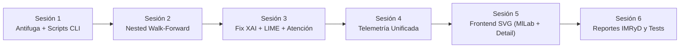

# Plan de Acción Integral — Fase 2: Módulo de Entrenamiento, XAI y Rigor Metodológico

**Proyecto:** DengAI-UNT (SP-01)  
**Objetivo:** Implementar la arquitectura modular del Módulo de Entrenamiento cumpliendo con los estándares de publicación en revista Scopus Q1/Q2 y las directivas de [anexo-profesor.md](file:///c:/D/UNT/10_CICLO/Trabajo%20de%20Investigaci%C3%B3n/IA%20DENGUE/DengAI-UNT/docs/research/anexo-profesor.md), protegiendo los resultados experimentales consolidados del manuscrito y corrigiendo las brechas detectadas en la auditoría técnica.

---

## 1. Decisiones Arquitectónicas Acordadas (Post-Auditoría)

1. **Protección y Trazabilidad de Resultados Científicos Consolidados:**
   - Se mantienen intactas las métricas, predicciones y figuras ya consolidadas en [Articulo_DengAI_UNT.docx](file:///c:/D/UNT/10_CICLO/Trabajo%20de%20Investigaci%C3%B3n/IA%20DENGUE/DengAI-UNT/materiales-manuscrito/Articulo_DengAI_UNT.docx), `data/models/` (`*-h1-optuna.joblib`, `preds-exp-colab-*.npz`) y `data/artifacts/experimentos/` ([tabla_1_metricas_rendimiento.csv](file:///c:/D/UNT/10_CICLO/Trabajo%20de%20Investigaci%C3%B3n/IA%20DENGUE/DengAI-UNT/data/artifacts/experimentos/tabla_1_metricas_rendimiento.csv)).
   - Los nuevos artefactos generados por los scripts CLI de Fase 2 se aislarán en `data/models/phase2/` y `data/reports/phase2/` para evitar sobreescritura accidental.
   - Se reconciliará explícitamente en reportes la procedencia de cada conjunto de resultados: (a) corrida principal Optuna Colab en test 2024 (`tabla_1_metricas_rendimiento.csv`), (b) corrida ligera local de verificación ([evaluacion_modelos_reales.json](file:///c:/D/UNT/10_CICLO/Trabajo%20de%20Investigaci%C3%B3n/IA%20DENGUE/DengAI-UNT/docs/research/evaluacion_modelos_reales.json)), y (c) nueva validación complementaria Nested Walk-Forward CV.
   - Se repararán las rutas absolutas obsoletas en `data/dengai.db` (`model_versions.artifact_path` con `10 CICLO` $\rightarrow$ `10_CICLO` o resolución relativa a `PROJECT_DIR`).
2. **Modularidad e Independencia (CLI Scripts) y Cero Fuga:**
   - Creación del directorio raíz `training/` con ejecutables independientes por modelo y argumentos consistentes (`--trials`, `--epochs`, `--horizon`, `--seed`, `--gpu`). En `XGBoost`, `--epochs` se mapeará explícitamente a `n_estimators` cuando se indique en pruebas rápidas (o vía `--n-estimators`) para que `--trials 1 --epochs 1` sea realmente acotado.
   - Corrección previa en [features.py](file:///c:/D/UNT/10_CICLO/Trabajo%20de%20Investigaci%C3%B3n/IA%20DENGUE/DengAI-UNT/backend/app/ml/features.py): eliminar el `.bfill()` global aplicado antes del split temporal (reemplazándolo por imputación estrictamente causal hacia adelante o ajustada por partición) y auditar la causalidad de ventanas móviles (`shift(1)`).
3. **Nested Walk-Forward CV Complementario:**
   - Incorporación de `training/run_nested_cv.py` (5 *outer folds* $\times$ 3 *inner folds* sobre las 495 semanas de desarrollo previas al bloque intocable de 26 semanas de test de 2024), con embargo temporal estricto (`target_week < val_start`) en ambos niveles, métricas completas del Anexo A (incluyendo `WIS`, `cobertura`, `MCC`, `F1`, `AUC-ROC`, `Brier`) y soporte de reanudación (`--resume`) por fold.
4. **Explicabilidad (XAI) Compatible con Modelos Secuenciales y Espaciales:**
   - Corrección estructural de [explain.py](file:///c:/D/UNT/10_CICLO/Trabajo%20de%20Investigaci%C3%B3n/IA%20DENGUE/DengAI-UNT/backend/app/ml/explain.py): hoy `_shap_values`, `_permutation_contributions` y `temporal_importance` fallan con `TypeError` en los 4 modelos PyTorch porque pasan `seq=None, grid=None, cell=None`. Se implementará un adaptador que reconstruya/perturbe `seq`, `grid` y `cell`.
   - En [torch_forecasters.py](file:///c:/D/UNT/10_CICLO/Trabajo%20de%20Investigaci%C3%B3n/IA%20DENGUE/DengAI-UNT/backend/app/ml/models/torch_forecasters.py) (`ConvLSTMAttentionNet`), se expondrán fielmente sus mecanismos reales: **atención temporal multi-cabezal** (`temporal_score`, $B \times T \times \text{heads}$) y **mapa de atención espacial monocanal** (`spatial_score`, $B \times H \times W$), sin atribuir multi-cabezal a la rama espacial.
   - Los scripts de XAI aceptarán los códigos reales del catálogo (`PE-LL-TRU`, `PE-LL-ASC`, etc., 14 distritos en `geographic_units`) con soporte opcional de alias UBIGEO (p. ej. `130101` $\rightarrow$ `PE-LL-TRU`).
5. **Telemetría Unificada (CLI + API) y Frontend Nativo:**
   - Canal compartido de telemetría (archivo JSONL por `run_id` en `data/reports/telemetry/` o tabla en BD) para que `GET /api/v1/ml/experiments/{id}/telemetry` muestre tanto ejecuciones lanzadas desde la API (`ExperimentRunner`) como ejecuciones CLI de `training/`.
   - Manejo seguro en entornos CPU (`torch==2.9.1+cpu` actualmente instalado): si `torch.cuda.is_available()` es `False`, reportar `gpu_available: false` y `gpu_vram_mb: null` (nunca `0` engañoso).
   - En Frontend, extender [ExperimentDetail.tsx](file:///c:/D/UNT/10_CICLO/Trabajo%20de%20Investigaci%C3%B3n/IA%20DENGUE/DengAI-UNT/frontend/src/pages/ExperimentDetail.tsx), [MlLab.tsx](file:///c:/D/UNT/10_CICLO/Trabajo%20de%20Investigaci%C3%B3n/IA%20DENGUE/DengAI-UNT/frontend/src/pages/MlLab.tsx) y [types.ts](file:///c:/D/UNT/10_CICLO/Trabajo%20de%20Investigaci%C3%B3n/IA%20DENGUE/DengAI-UNT/frontend/src/api/types.ts) reutilizando los gráficos SVG nativos de [charts.tsx](file:///c:/D/UNT/10_CICLO/Trabajo%20de%20Investigaci%C3%B3n/IA%20DENGUE/DengAI-UNT/frontend/src/components/charts.tsx) (sin instalar `recharts`).
6. **Reportes IMRyD Completos:**
   - Exportación automatizada de tablas Markdown/CSV/LaTeX y figuras 300/600 DPI + SVG incluyendo las **5 pruebas estadísticas del Anexo A**: Friedman, Wilcoxon-Holm, McNemar, DeLong y **Diebold-Mariano**.

---

## 2. Matriz de Asignación Operativa (Ahorro de Tokens y Recursos)

| Componente / Tarea | Responsable | Mecanismo | Razón de Eficiencia |
| :--- | :--- | :--- | :--- |
| **Definición de scripts, corrección XAI y lógica matemática** | **Agente (IA)** | Código Python/TypeScript | Garantiza rigor en tensores, causalidad y métricas |
| **Instalación de `lime` y actualización de `requirements.txt`** | **Usuario (Manual)** | Terminal PowerShell (`pip install lime`) | Única librería faltante (`torch`, `xgboost`, `optuna`, `shap`, `psutil`, `pytest`, `matplotlib` ya presentes) |
| **Ejecución de entrenamientos largos / Nested CV completo** | **Usuario (Manual)** | Google Colab (GPU) o terminal local con `--resume` | Evita timeouts (`convlstm` toma ~183 s por 4 épocas en CPU local) |
| **Pruebas unitarias y validación antifuga** | **Agente (IA)** | Ejecución de `pytest` focalizado en sandbox | Verificación determinista y reproducible |
| **Revisión visual de tablas/figuras en el manuscrito** | **Usuario (Manual)** | Microsoft Word | Inspección editorial directa |

---

## 3. Desglose de Sesiones Incrementales



---

### Sesión 1: Saneamiento Antifuga y Modularización de Scripts CLI en `training/`

- **Objetivo:** Corregir la imputación con fuga en `features.py`, normalizar rutas rotas en `data/dengai.db`, y crear la carpeta `training/` con scripts ejecutables independientes reutilizando `backend/app/ml/`, guardando en `data/models/phase2/`.
- **Estructura a implementar / actualizar:**
  - `backend/app/ml/features.py` (eliminar `.bfill()` previo al split temporal; verificar causalidad de ventanas móviles).
  - `training/common.py` (parsing CLI `--trials`, `--epochs`, `--horizon`, `--seed`, `--gpu`, `--output-dir`, carga de panel desde Fase 1, registro de telemetría JSONL por `run_id`).
  - `training/train_xgboost.py` (mapeo explícito de `--epochs` / `--n-estimators` para corridas rápidas).
  - `training/train_lstm.py`
  - `training/train_convlstm.py`
  - `training/train_cnn_lstm.py`
  - `training/train_convlstm_attention.py`
  - `training/optimize_optuna.py`
- **Paso Manual del Usuario (Opcional):**
  Ninguno requerido; utiliza el entorno Python existente.
- **Prompt Autocontenido para Copiar y Pegar:**
  ```text
  Ejecuta la Sesión 1 de la Fase 2 del proyecto DengAI-UNT:
  1. En 'backend/app/ml/features.py', elimina la fuga temporal del '.bfill()' global previo al split temporal (usa ffill causal o imputación ajustada solo con train) y verifica que ninguna ventana móvil use datos futuros para t+h.
  2. Verifica y corrige rutas de artefactos obsoletas en 'data/dengai.db' ('10 CICLO' -> '10_CICLO' o resolución relativa) sin modificar los archivos consolidados de 'data/models/*.joblib'.
  3. Crea 'training/' en la raíz con scripts CLI independientes:
     - training/common.py (CLI args, carga de panel real/auto, validación de dimensiones, escritor de telemetría JSONL en data/reports/telemetry/)
     - training/train_xgboost.py (mapeando --epochs cuando se especifique para pruebas rápidas o vía --n-estimators)
     - training/train_lstm.py
     - training/train_convlstm.py
     - training/train_cnn_lstm.py
     - training/train_convlstm_attention.py
     - training/optimize_optuna.py
  Cada script debe aceptar (--trials, --epochs, --horizon, --seed, --gpu, --output-dir con defecto data/models/phase2/) y jamás sobreescribir los artefactos consolidados en data/models/. Verifica con una prueba rápida (--trials 1 --epochs 1 --horizon 1) para cada modelo y con test antifuga.
  ```
- **Criterio de Verificación / Checkpoint:**
  Ejecutar en terminal:  
  `python training/train_xgboost.py --trials 1 --epochs 1 --horizon 1`  
  Comprobar código de salida `0`, generación de checkpoint bajo `data/models/phase2/` sin alterar `data/models/*-optuna.joblib`, y archivo de telemetría en `data/reports/telemetry/`.

---

### Sesión 2: Módulo Complementario de Nested Walk-Forward CV

- **Objetivo:** Implementar `training/run_nested_cv.py` con división cronológica de **5 outer folds $\times$ 3 inner folds** sobre las ~495 semanas de desarrollo previas a las 26 semanas intocables de test de 2024, garantizando cero fuga en ambos niveles y soporte de reanudación.
- **Detalle Técnico:**
  - *Outer loop:* 5 folds expansivos (`validation_weeks=26`, `test_weeks=26` reservadas fuera).
  - *Inner loop:* 3 folds expansivos internos (`inner_val_weeks=13` por defecto, configurable vía `--inner-val-weeks`) aplicando embargo estricto `target_week < inner_val_start` y `inner_val_target_week < outer_val_start`.
  - Métricas por fold externo (5 observaciones por modelo): `MAE`, `RMSE`, `MASE`, `WIS`, `coverage`, `AUC_PR`, `AUC_ROC`, `F1`, `MCC`, `sensitivity`, `specificity`, `Brier` y `tiempo_s`, más agregados (Media, DE, Mín, Máx, IC 95%).
  - Soporte de `--resume` / guardado incremental por `(modelo, outer_fold)` en `data/reports/phase2/nested_cv_results.json`.
- **Paso Manual del Usuario:**
  Para corridas completas con 50+ trials en los 4 modelos PyTorch, ejecutar en Google Colab (GPU) usando `--resume` para proteger contra desconexiones.
- **Prompt Autocontenido para Copiar y Pegar:**
  ```text
  Ejecuta la Sesión 2 de la Fase 2 del proyecto DengAI-UNT:
  Implementa 'training/run_nested_cv.py' que ejecuta Validación Cruzada Anidada temporal tipo Walk-Forward (5 outer folds x 3 inner folds) sobre la historia previa al bloque intocable de 26 semanas de prueba:
  1. Garantiza estricta ausencia de fuga temporal en ambos niveles: 'max(target_week) < min(val_origin_week)' tanto entre inner_train/inner_val como entre outer_train/outer_val para cualquier horizonte h.
  2. Permite configurar --models, --horizon, --trials, --epochs, --outer-folds 5, --inner-folds 3, --inner-val-weeks 13 y --resume.
  3. Ejecuta Optuna en los 3 inner folds, reentrena en outer_train y evalúa una sola vez en outer_val.
  4. Registra exactamente 5 observaciones externas por modelo con todas las métricas del Anexo A (MAE, RMSE, MASE, WIS, coverage, AUC_PR, AUC_ROC, F1, MCC, sensitivity, specificity, Brier, tiempo_s) y calcula media, DE, mín, máx e IC 95%.
  5. Guarda incrementalmente por fold en data/reports/phase2/nested_cv_results.json.
  Verifica ejecutando una prueba rápida (--models xgboost --trials 1 --epochs 1) y comprobando matemáticamente con aserciones que no existe solapamiento temporal ni de objetivos en ningún fold.
  ```
- **Criterio de Verificación / Checkpoint:**
  Ejecutar:  
  `python training/run_nested_cv.py --models xgboost --trials 1 --epochs 1 --horizon 1`  
  Verificar que `data/reports/phase2/nested_cv_results.json` contenga exactamente 5 bloques externos y que todos los índices `target_week` de entrenamiento sean estrictamente menores a `origin_week` de validación en ambos niveles.

---

### Sesión 3: Corrección de XAI en PyTorch, LIME Tabular y Mapas de Atención Reales

- **Objetivo:** Corregir el fallo actual de `backend/app/ml/explain.py` sobre modelos PyTorch (`seq`/`grid`/`cell`), exponer los pesos reales de atención de `ConvLSTMAttentionNet` y crear `training/explain_models.py` con SHAP + LIME + rezagos + exportación vectorial.
- **Detalle Técnico:**
  - **Fix en `explain.py`:** Reemplazar llamadas que pasan `seq=None, grid=None, cell=None` por un adaptador que mapee perturbaciones tabulares/de ventana sobre `seq` (`LSTM`) y sobre la celda correspondiente en `grid` (`ConvLSTM`, `CNN-LSTM`, `ConvLSTM-Attention`).
  - **Pesos reales en `ConvLSTMAttentionNet` (`torch_forecasters.py`):** Exponer método/flag `forward_with_attention(grid, cell)` o atributos cacheados para extraer:
    - `temporal_weights`: tensor `(B, T, heads)` / `(B, T)` de `self.temporal_score` (atención temporal multi-cabezal).
    - `spatial_weights`: tensor `(B, H, W)` de `self.spatial_score` (atención espacial monocanal real).
  - **LIME:** Integrar `lime.lime_tabular.LimeTabularExplainer` sobre fondo del conjunto de entrenamiento (compatible con XGBoost y wrapper de redes).
  - **Códigos distritales:** Usar los códigos reales de la BD (`PE-LL-TRU`, `PE-LL-ASC`, etc.) y aceptar UBIGEO como alias opcional (`130101` $\rightarrow$ `PE-LL-TRU`).
  - **Visualizaciones:** Exportar gráficos en PNG (300 DPI) y SVG en `data/reports/xai/`.
- **Paso Manual del Usuario:**
  Instalar `lime` en el entorno Python y confirmar su presencia en `backend/requirements.txt`:  
  `pip install lime`
- **Prompt Autocontenido para Copiar y Pegar:**
  ```text
  Ejecuta la Sesión 3 de la Fase 2 del proyecto DengAI-UNT:
  1. Corrige 'backend/app/ml/explain.py' para que SHAP, permutación e importancia temporal funcionen tanto en XGBoost como en los 4 modelos PyTorch (LSTM, ConvLSTM, CNN-LSTM, ConvLSTM-Attention) sin lanzar TypeError por seq=None/grid=None.
  2. En 'backend/app/ml/models/torch_forecasters.py', añade inspección limpia en ConvLSTMAttentionNet para devolver/capturar 'temporal_weights' (atención temporal multi-cabezal de temporal_score) y 'spatial_weights' (atención espacial monocanal de spatial_score).
  3. Implementa 'training/explain_models.py' (y amplía 'backend/app/ml/explain.py') con:
     - LIME tabular local (LimeTabularExplainer) con fondo de train.
     - Extracción de mapas de atención espacial (grilla 4x5 mapeada a los 13/14 distritos reales) y pesos de atención temporal.
     - Importancia acumulada de rezagos (t-1 a t-12) para clima y casos.
     - Exportación PNG (300 DPI) + SVG + JSON en 'data/reports/xai/'.
     - Soporte de códigos 'PE-LL-*' (p. ej. PE-LL-TRU) y alias UBIGEO (p. ej. 130101 -> PE-LL-TRU), más --model-path opcional.
  Verifica ejecutando sobre el modelo XGBoost y sobre un modelo ConvLSTM-Attention (ruta local válida) generando los archivos reales en data/reports/xai/.
  ```
- **Criterio de Verificación / Checkpoint:**
  Ejecutar:  
  `python training/explain_models.py --district "PE-LL-TRU" --week 202415`  
  Comprobar generación real (sin fallback silencioso por error) de LIME, SHAP/atribución, mapa de atención espacial/temporal y archivos `.png`/`.svg`/`.json` en `data/reports/xai/`.

---

### Sesión 4: Telemetría Unificada de Monitoreo en Tiempo Real y API

- **Objetivo:** Implementar la telemetría de entrenamiento paso a paso en `backend/app/ml/trainer.py` y un lector unificado (soportando `ExperimentRunner` en hilo y ejecuciones CLI vía `data/reports/telemetry/{run_id}.jsonl`) expuesto en `backend/app/api/v1/ml.py`.
- **Detalle Técnico:**
  - Registro por época y trial: `epoch`, `max_epochs`, `train_loss`, `val_loss` / `val_mae`, `trial`, `n_trials`, `best_score`, `elapsed_s`, `eta_s`, `source` (`api` | `cli`).
  - Monitor de hardware con `psutil` y detección segura de CUDA: `cpu_pct`, `ram_pct`, `ram_used_mb`, `gpu_available` (`bool`), `gpu_vram_mb` (`float | None`, `null` en CPU con `torch==2.9.1+cpu`).
  - Endpoint `GET /api/v1/ml/experiments/{id}/telemetry` (y opcionalmente por `run_id`) con esquema Pydantic en `backend/app/schemas/ml.py`.
- **Paso Manual del Usuario:**
  Confirmar que `psutil` responde en el entorno (ya verificado instalado).
- **Prompt Autocontenido para Copiar y Pegar:**
  ```text
  Ejecuta la Sesión 4 de la Fase 2 del proyecto DengAI-UNT:
  Actualiza 'backend/app/ml/trainer.py', 'backend/app/schemas/ml.py' y 'backend/app/api/v1/ml.py':
  1. Incorpora telemetría paso a paso en el ciclo de entrenamiento (época actual/total, pérdida train/val, trial de Optuna, mejor score, tiempo transcurrido y ETA) escribiendo en un almacén compartido (archivo JSONL en data/reports/telemetry/{run_id}.jsonl y/o estado en memoria/BD con lock seguro) compatible con los scripts CLI de 'training/'.
  2. Agrega consumo de hardware (CPU %, RAM %/MB con psutil; GPU VRAM MB con torch.cuda solo si torch.cuda.is_available(), retornando gpu_available=False y gpu_vram_mb=None en entornos CPU).
  3. Implementa el endpoint GET /api/v1/ml/experiments/{id}/telemetry (y soporte para consultar corridas CLI registradas por run_id) con su esquema Pydantic.
  4. Crea una prueba unitaria rápida 'backend/tests/test_telemetry.py' usando sesión/BD aislada en memoria que valide el esquema completo y el comportamiento en CPU sin simular métricas falsas.
  ```
- **Criterio de Verificación / Checkpoint:**
  Ejecutar `python -m pytest backend/tests/test_telemetry.py -v` y comprobar que todas las aserciones pasan en verde.

---

### Sesión 5: Interfaz de Monitoreo en Frontend (`MlLab.tsx` y `ExperimentDetail.tsx`)

- **Objetivo:** Actualizar la vista del Laboratorio de IA y el detalle de experimento en React usando el sistema gráfico SVG nativo del proyecto (`frontend/src/components/charts.tsx`), sin añadir librerías externas como `recharts`.
- **Detalle Técnico:**
  - Actualizar contratos TypeScript en `frontend/src/api/types.ts` para `ExperimentTelemetry`.
  - En `frontend/src/pages/ExperimentDetail.tsx` y `frontend/src/pages/MlLab.tsx` + nuevos componentes modulares en `frontend/src/components/ml/`:
    - **Panel de Telemetría en Vivo:** curva SVG multi-serie (`LineChart` de `charts.tsx` o SVG dedicado) de `train_loss` vs `val_mae/loss`, indicadores de `CPU %`, `RAM %` y `GPU VRAM` (mostrando `"CPU mode"` si `gpu_vram_mb === null`), barra de trials Optuna, tiempo transcurrido y ETA.
    - **Explorador de Explicabilidad (XAI):** desglose LIME vs SHAP local, mapa de calor espacial (grilla $4 \times 5$ / distritos de La Libertad) y gráfico de barras de rezagos temporales ($t-1$ a $t-12$).
- **Paso Manual del Usuario:**
  Verificar dependencias existentes en `frontend/` (no requiere instalar `recharts`).
- **Prompt Autocontenido para Copiar y Pegar:**
  ```text
  Ejecuta la Sesión 5 de la Fase 2 del proyecto DengAI-UNT:
  Actualiza 'frontend/src/api/types.ts', 'frontend/src/pages/ExperimentDetail.tsx', 'frontend/src/pages/MlLab.tsx' y crea componentes en 'frontend/src/components/ml/' reutilizando los gráficos SVG nativos de 'frontend/src/components/charts.tsx' (NO instales recharts ni dependencias externas):
  1. Panel de telemetría en vivo conectado a GET /api/v1/ml/experiments/{id}/telemetry: curva SVG Train vs Val, indicador de época y trials de Optuna, medidores de CPU/RAM/GPU (indicando modo CPU si gpu_vram_mb es null) y ETA.
  2. Sección de Explicabilidad Avanzada (XAI): visualizador de contribuciones locales LIME/SHAP, mapa de calor de pesos de atención espacial y gráfico de rezagos temporales (t-1 a t-12).
  3. Verifica tipos y compilación ejecutando 'pnpm run typecheck' y 'pnpm run build' (o npm) en 'frontend/' con 0 errores.
  ```
- **Criterio de Verificación / Checkpoint:**
  Ejecutar en `frontend/`:  
  `pnpm run typecheck && pnpm run build`  
  Verificar salida con código `0` y sin errores de TypeScript o Vite.

---

### Sesión 6: Suite de Pruebas de Integración y Generación de Reportes IMRyD

- **Objetivo:** Consolidar pruebas automatizadas de Fase 2 (sin fuga, XAI PyTorch, Nested CV, telemetría) y crear `training/generate_reports.py` para exportar tablas definitivas y pruebas estadísticas completas del Anexo A sin mezclar series históricas.
- **Detalle Técnico:**
  - Suite `backend/tests/test_phase2_training.py`: verifica los 5 modelos en corrida acotada, consistencia matemática de métricas (`MAE <= RMSE`, `coverage in [0,1]`), ausencia de fuga en `features.py` y `run_nested_cv.py`, funcionamiento real de `explain.py` sobre modelos PyTorch + LIME, y telemetría.
  - Script `training/generate_reports.py`: genera tablas en Markdown, CSV y LaTeX en `data/reports/phase2/` a partir de artefactos reales verificados en disco:
    - Tabla comparativa de los 5 modelos (manteniendo trazabilidad separada entre test 2024 Optuna y Nested Walk-Forward CV).
    - Resumen completo de las **5 pruebas estadísticas del Anexo A**: Friedman, Wilcoxon-Holm, McNemar, DeLong y **Diebold-Mariano** (reutilizando `backend/app/ml/stats_tests.py`).
    - Figuras en alta resolución listas para inserción en [Articulo_DengAI_UNT.docx](file:///c:/D/UNT/10_CICLO/Trabajo%20de%20Investigaci%C3%B3n/IA%20DENGUE/DengAI-UNT/materiales-manuscrito/Articulo_DengAI_UNT.docx).
- **Paso Manual del Usuario:**
  Abrir [Articulo_DengAI_UNT.docx](file:///c:/D/UNT/10_CICLO/Trabajo%20de%20Investigaci%C3%B3n/IA%20DENGUE/DengAI-UNT/materiales-manuscrito/Articulo_DengAI_UNT.docx) y revisar las nuevas tablas complementarias (Nested CV y XAI) verificando consistencia numérica con las tablas originales.
- **Prompt Autocontenido para Copiar y Pegar:**
  ```text
  Ejecuta la Sesión 6 de la Fase 2 del proyecto DengAI-UNT:
  1. Implementa 'training/generate_reports.py' leyendo exclusivamente artefactos reales generados (sin inventar ni hardcodear números): consolida métricas de los 5 modelos, resultados de Nested CV (5x3), las 5 pruebas estadísticas del Anexo A (Friedman, Wilcoxon-Holm, McNemar, DeLong y Diebold-Mariano vía backend/app/ml/stats_tests.py) y salidas XAI en Markdown, CSV y LaTeX bajo data/reports/phase2/.
  2. Crea 'backend/tests/test_phase2_training.py' validando ausencia de fuga en features/nested CV, métricas con oráculo independiente, XAI en XGBoost y PyTorch (SHAP/LIME/atención) y telemetría.
  3. Ejecuta pytest sobre 'backend/tests/test_phase2_training.py' y 'backend/tests/test_telemetry.py' (y el resto de la suite unitaria) garantizando 100% de pruebas aprobadas.
  4. Actualiza 'docs/technical/informe-tecnico.md' y 'docs/research/protocolo-experimental.md' diferenciando explícitamente los resultados de prueba sintética, corrida ligera local, corrida Optuna principal y Nested CV complementario.
  ```
- **Criterio de Verificación / Checkpoint:**
  Ejecutar:  
  `python -m pytest backend/tests/test_phase2_training.py backend/tests/test_telemetry.py -v`  
  Comprobar que todas las pruebas pasen al 100% y que los reportes generados en `data/reports/phase2/` trazan exactamente su archivo fuente.
